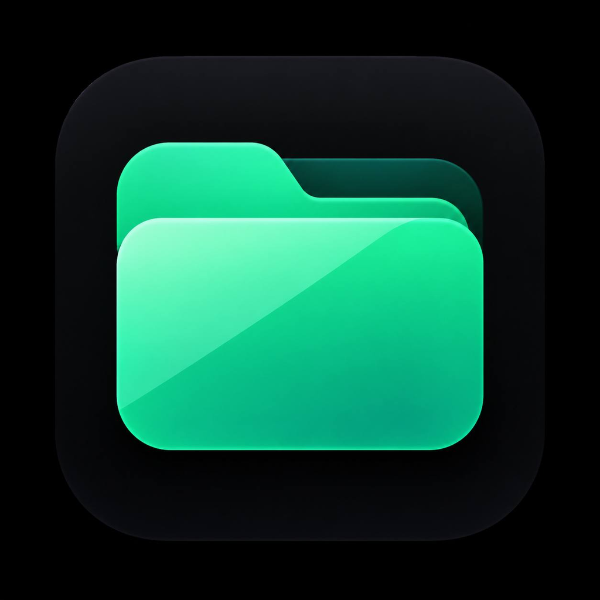

<p align="center">
  
</p>

# Bile

A fast, escape-free file manager for iOS.

Bile browses your iPhone's filesystem directly from `/`, lists every installed
app through LaunchServices, and keeps a clean activity log. It contains **no
sandbox escape and no exploit code**: whatever iOS refuses to open, Bile
labels "Permission denied" instead of pretending. When a real sandbox escape
ships, it slots into one small layer (`LocalFS`) and every path above lights up.

## Download

Grab the latest unsigned IPA from
[Releases](https://github.com/d3vin4/Bile/releases) and install it with
your preferred sideloading tool (TrollStore, AltStore, Sideloadly, …).

## Tabs

### Files

A full browser rooted at `/` on a charcoal dark theme:

- Breadcrumb bar — tap any segment to jump; back / forward / up with history
- Go-to-path sheet with recents, favorites (bookmark any folder)
- Hidden (dot) files toggle · six sort orders · list & grid view
- Pull to refresh · in-folder filter · recursive search
- Multi-select with a tool bar: share, copy, cut, compress, copy paths,
  select all, delete
- New folder, new file, new symlink · rename · duplicate
- Copy / cut / paste with conflict-safe naming
- Recursive delete with confirmation (symlinks are never followed)
- Info sheet: size, dates, owner, chmod editor, symlink target
- Calculate folder size (recursive, off the main thread)
- Text editor with save
- **Plist viewer** — structured tree for XML/binary plists, JSON and
  provisioning profiles, with search, expand/collapse, and edit-as-text
- QuickLook preview for anything iOS can render
- Compress to ZIP and extract ZIP (STORE + DEFLATE via Apple's Compression
  framework, symlink- and traversal-safe extraction)

### Apps

- Every installed app through LaunchServices (bundle id, version, type)
- Real icons read from each bundle
- Data-container paths shown; containers open into Files when iOS allows it
  and are clearly marked locked when it does not

### Logs

- Timestamped activity log with a bounded buffer
- Filter, share, clear
- **Credits** — app icon, version, and the author's GitHub profile & avatar

## Build

The IPA is built automatically on every push to `main`
(GitHub Actions, macOS 26 / Xcode 26, XcodeGen for project generation).
To build locally:

```bash
brew install xcodegen
xcodegen generate
./build-ipa.sh Release
# → build/Bile.ipa
```

## Credits

Made by [**@d3vin4**](https://github.com/d3vin4)
 —
project and releases live at
[github.com/d3vin4/Bile](https://github.com/d3vin4/Bile).

## License

MIT — see [LICENSE](LICENSE).
